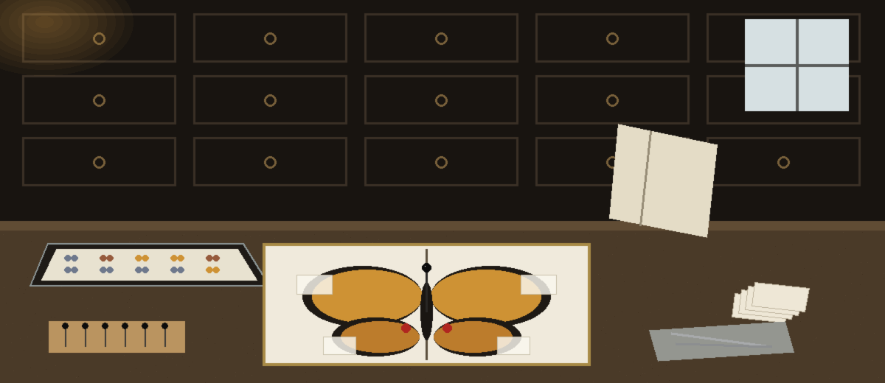

# analyze-network-protocol-fuzzer

The Butterfly Collector's Setting Board: a fragile structure held open under steady, recorded pressure until its final shape is known.

# analyze-network-protocol-fuzzer
A command-line tool that fuzzes network protocols by generating and sending malformed packets to a target service to identify potential vulnerabilities or crashes. It sends random, mutated, or oversized random byte packets to a named target. - Focused on Data analysis and reporting

## Install
`git clone https://github.com/ShadowGuardAI/analyze-network-protocol-fuzzer`

## Usage
`./analyze-network-protocol-fuzzer [params]`

## Parameters
- `-h`: Show help message and exit
- `-t`: Target IP address or hostname.
- `-p`: Target port number.
- `-P`: No description provided
- `-n`: Number of packets to send. Default: 100
- `-s`: Size of each packet in bytes. Default: 100
- `-d`: No description provided
- `-f`: Fuzzing type: random, mutate, or overflow. Default: random
- `-m`: Mutation rate for 
- `-o`: Overflow amount for 
- `-l`: Path to the log file. If not specified, logs will be printed to the console.
- `-r`: No description provided

## License
Copyright (c) ShadowGuardAI

> Torn label note: -m is cut off at Mutation rate for and -o is cut off at Overflow amount for in the source, each phrase missing the noun it was about to name, and -P, -d, and -r arrive with no description provided. None of the five is completed here by guess.
